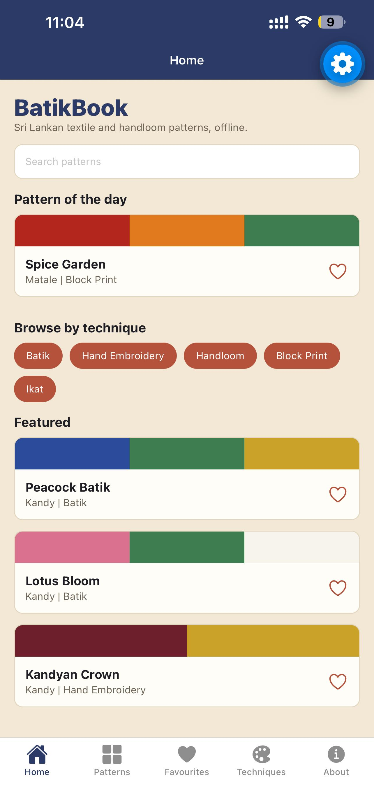
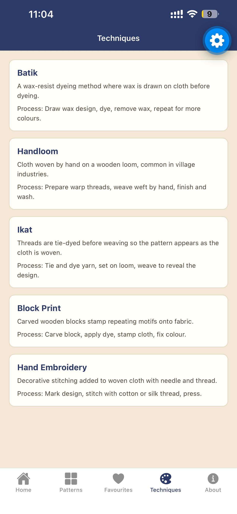

# BatikBook: Offline Textile & Handloom Pattern Catalogue

React Native (Expo) app. Works fully offline: data is bundled JSON, favourites are saved with AsyncStorage.

## Setup
```
npx create-expo-app@latest BatikBook --template blank
cd BatikBook
npx expo install @react-navigation/native @react-navigation/native-stack @react-navigation/bottom-tabs react-native-screens react-native-safe-area-context @react-native-async-storage/async-storage @expo/vector-icons
```
Copy `App.js`, `data/`, `screens/`, `components/`, `utils/` from this project over the new one, then run `npx expo start`.

## Screens
Home, Patterns (search, region and technique filters, sort), Pattern Details, Favourites, Techniques, About.

## Screenshots


